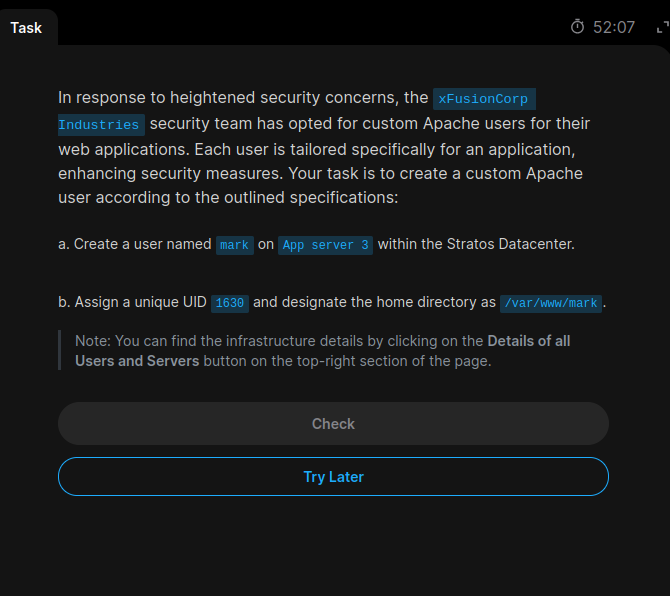
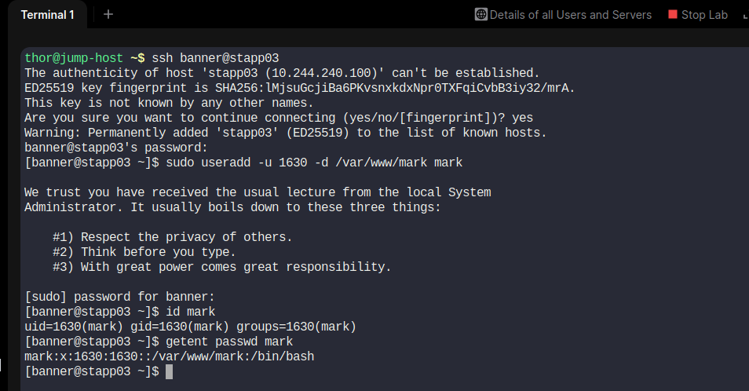

# Task 01: Custom Apache User Setup

**Platform:** KodeKloud Engineer  
**Level:** Level 1 – Linux  
**Date:** 31 October 2026  
**Status:** Completed ✅

## 1. Task Description

The xFusionCorp Industries security team decided to create custom Apache users for their web applications to improve security.

### Requirements

- Create a user named `mark` on Application Server 3.
- Assign a unique UID `1630`.
- Set the home directory to `/var/www/mark`.

## 2. Infrastructure Details

| Parameter | Value |
|---|---|
| Server | Application Server 3 |
| Hostname | stapp03 |
| Login User | banner |
| New Username | mark |
| UID | 1630 |
| Home Directory | /var/www/mark |

## 3. Implementation

### Step 1: Connect to Application Server 3

```bash
ssh banner@stapp03
```

### Step 2: Create the custom Apache user

```bash
sudo useradd -u 1630 -d /var/www/mark mark
```

### Step 3: Verify user creation

```bash
id mark
```

Output:

```text
uid=1630(mark) gid=1630(mark) groups=1630(mark)
```

### Step 4: Verify user information

```bash
getent passwd mark
```

Output:

```text
mark:x:1630:1630::/var/www/mark:/bin/bash
```

## 4. Command Explanation

| Command | Explanation |
|---|---|
| `ssh` | Connects to a remote Linux server |
| `useradd` | Creates a new Linux user |
| `-u` | Assigns a specific UID |
| `-d` | Specifies the home directory path |
| `id` | Displays UID and group information |
| `getent passwd` | Retrieves Linux user account details |

**Important:** The `-d` option configures the home directory path in the user account. It does not automatically create the physical directory.

## 5. Screenshot Evidence

### Task Question



### Task Solution



## 6. Final Verification

- [x] Connected to Application Server 3.
- [x] Created user `mark`.
- [x] Assigned UID `1630`.
- [x] Configured home directory `/var/www/mark`.
- [x] Verified user information.
- [x] Captured task and solution screenshots.

## 7. Key Learning Outcomes

Through this task, I learned:

1. Linux user management.
2. Creating users with custom UIDs.
3. Configuring custom home directories.
4. Verifying user details through `/etc/passwd` and `id`.

**Result: Successfully Completed.**
