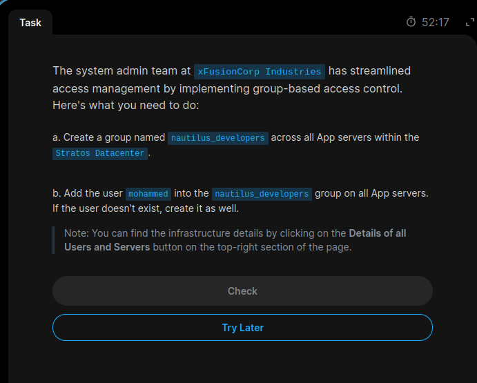
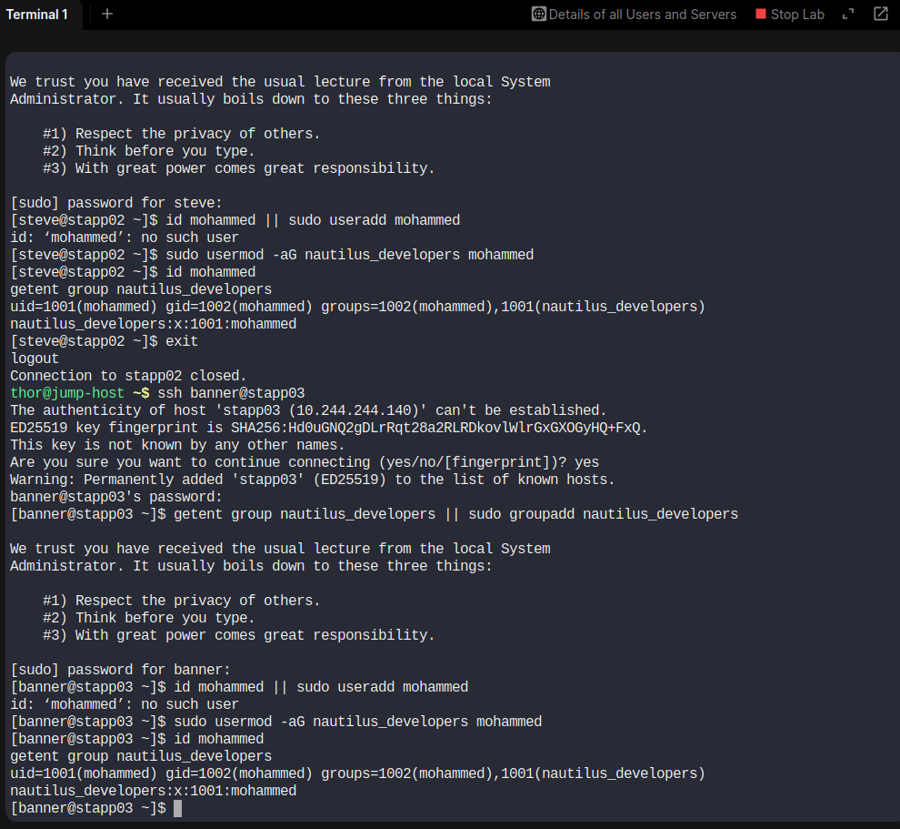

# Task 02: Group Creation and User Assignment

**Platform:** KodeKloud Engineer  
**Level:** Level 1 – Linux  
**Date:** 31 October 2026  
**Status:** Successfully Completed

## 1. Task Description

The xFusionCorp Industries system administration team implemented group-based access control to simplify Linux user and group management.

### Requirements

1. Create a group named `nautilus_developers` on all App Servers.
2. Add the user `mohammed` to the `nautilus_developers` group.
3. If the user does not exist, create the user.

## 2. Infrastructure Details

| Server | Hostname |
|---|---|
| Application Server 1 | stapp01 |
| Application Server 2 | stapp02 |
| Application Server 3 | stapp03 |

### User and Group Details

| Parameter | Value |
|---|---|
| Username | mohammed |
| Group Name | nautilus_developers |
| Servers | All three App Servers |

## 3. Linux Commands Used

### Step 1: Check whether the group exists

```bash
getent group nautilus_developers
```

### Step 2: Create the group if it does not exist

```bash
sudo groupadd nautilus_developers
```

### Step 3: Check whether the user exists

```bash
id mohammed
```

### Step 4: Create the user if it does not exist

```bash
sudo useradd mohammed
```

### Step 5: Add the user to the group

```bash
sudo usermod -aG nautilus_developers mohammed
```

### Step 6: Verify user and group membership

```bash
id mohammed
```

```bash
groups mohammed
```

```bash
getent group nautilus_developers
```

These operations were performed on all three application servers.

## 4. Command Explanation

| Command | Purpose |
|---|---|
| `groupadd` | Creates a new Linux group |
| `useradd` | Creates a new Linux user |
| `usermod` | Modifies an existing user |
| `-aG` | Appends a supplementary group |
| `id` | Displays UID, GID and group membership |
| `groups` | Displays groups associated with a user |
| `getent group` | Retrieves group information |

## 5. Important Linux Concept

### Difference between -G and -aG

- `-G`: Specifies supplementary groups and can replace existing supplementary group memberships.
- `-aG`: Adds a supplementary group without removing existing memberships.

Using `-aG` is recommended when adding a user to an additional group.

## 6. Screenshot Evidence

### Task Question



### Task Solution



## 7. Final Verification Checklist

- [x] Created `nautilus_developers` group.
- [x] Created `mohammed` if required.
- [x] Added `mohammed` to the group.
- [x] Configured all three App Servers.
- [x] Verified group membership.

## 8. Learning Outcomes

- Learned Linux group management.
- Practiced creating Linux groups.
- Learned how to add users to supplementary groups.
- Understood the difference between primary and supplementary groups.
- Practiced user and group verification across multiple Linux servers.

**Result: Successfully Completed.**

