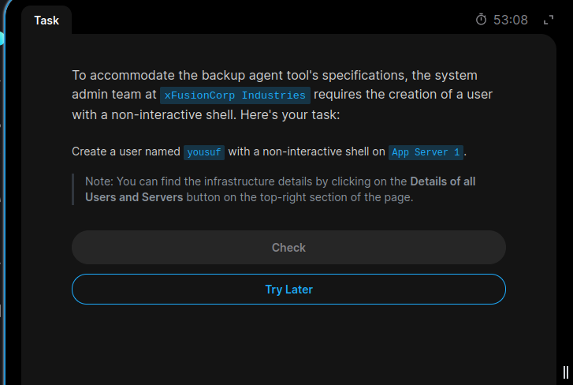
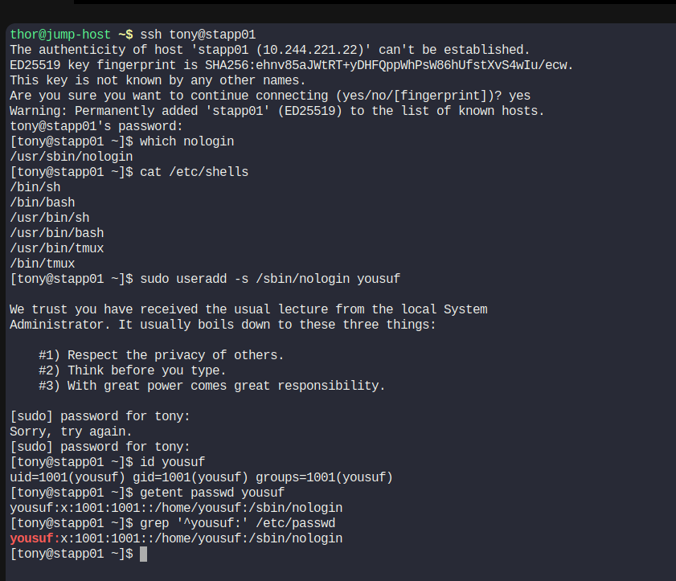

# Task 3: Linux User Setup with Non-Interactive Shell

## Objective
Create a user named `yousuf` on App Server 1 (`stapp01`) with a non-interactive login shell.

## Server Details
- Server: App Server 1
- Hostname: stapp01
- User to create: yousuf
- Shell: `/sbin/nologin` (confirm the path available on the server)

## Commands Used

```bash
# Check the nologin shell path
which nologin

# Create user with a non-interactive shell
sudo useradd -s /sbin/nologin yousuf

# Verify user details
id yousuf

# Verify the configured login shell
getent passwd yousuf
```

## Explanation

- `useradd`: Creates a new Linux user.
- `-s`: Specifies the user's login shell.
- `/sbin/nologin`: Prevents the user from obtaining an interactive login shell.
- `id`: Displays the user's UID, GID and group memberships.
- `getent passwd`: Displays the user's account information, including the configured shell.

## Screenshot Evidence

### Task Question


### Task Solution


## Learning Outcome

Learned how to create a Linux user with a non-interactive shell and verify the account configuration.o

