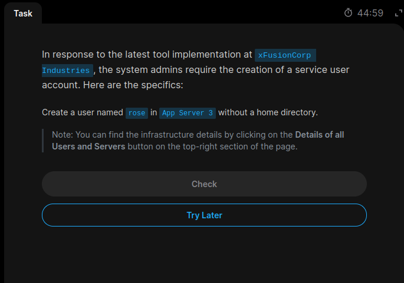
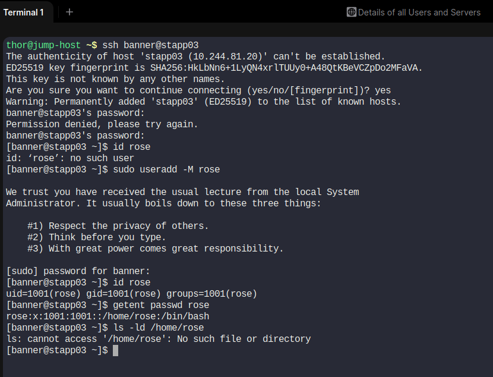

# Task 4: Service User Creation Without Home Directory

## Objective
Create a user named `rose` on App Server 3 (`stapp03`) without creating a home directory.

## Server Details
- Server: App Server 3
- Hostname: stapp03
- User created: rose
- UID: 1001
- Home directory: Not physically created

## Commands Used

```bash
# Connect to App Server 3
ssh banner@stapp03

# Check whether user exists
id rose

# Create user without home directory
sudo useradd -M rose

# Verify user
id rose

# Check account details
getent passwd rose

# Verify home directory does not exist
ls -ld /home/rose
```

## Explanation

- `useradd`: Creates a new Linux user.
- `-M`: Prevents creation of the home directory.
- `id`: Displays UID, GID and group information.
- `getent passwd`: Displays user account details.
- `ls -ld`: Checks whether the directory exists.

**Important:** The `/etc/passwd` entry can still contain `/home/rose` as the configured home path even though the physical directory was not created.

## Verification

User creation:
```text
uid=1001(rose) gid=1001(rose) groups=1001(rose)
```

Account details:
```text
rose:x:1001:1001::/home/rose:/bin/bash
```

Home directory check:
```text
No such file or directory
```

## Screenshot Evidence

### Task Question


### Task Solution


## Learning Outcome

Learned how to create a Linux service account without creating a physical home directory using the `useradd -M` command.
