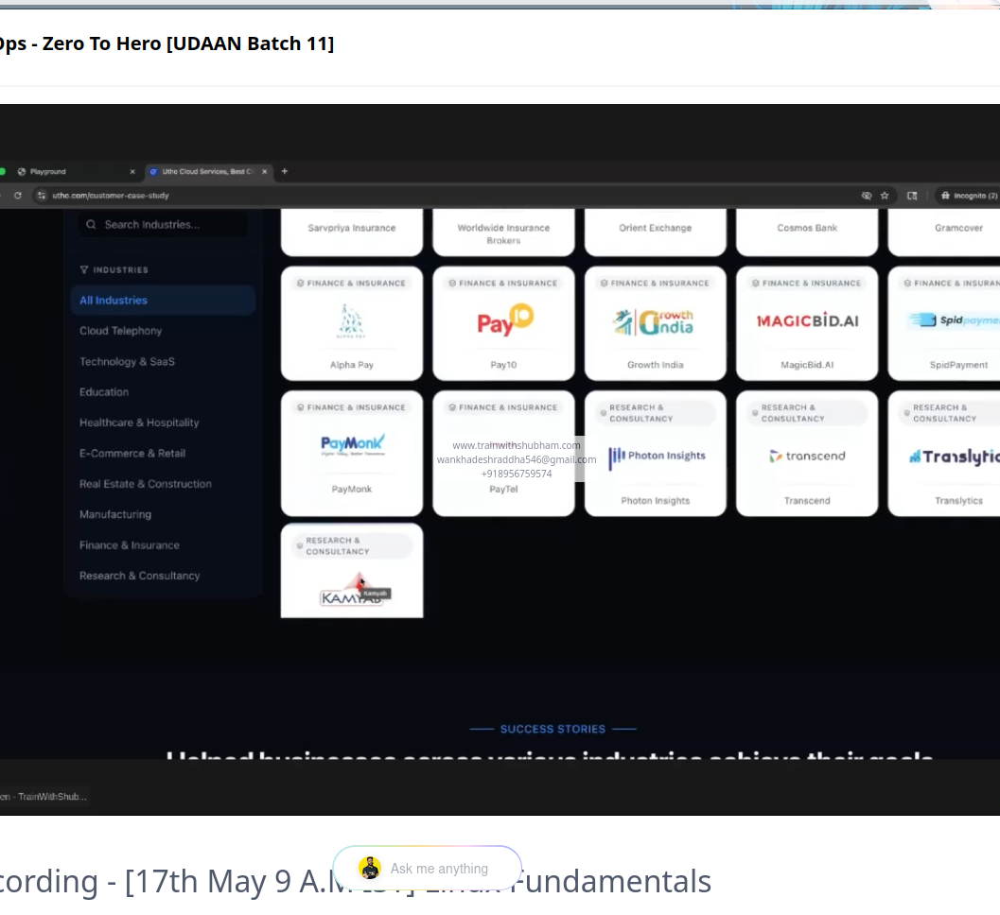

# 05 - Create a User with an Expiry Date

## Objective

Create a temporary Linux user named `mark` on App Server 1 in the Stratos Datacenter and configure an account expiration date.

## Task Requirements

- Server: App Server 1 (`stapp01`)
- Username: `mark`
- Account Expiry Date: `2027-03-28`
- Username must be lowercase.

## Implementation

### Step 1: Connect to App Server 1

```bash
ssh tony@stapp01
```

### Step 2: Create the temporary user

```bash
sudo useradd -e 2027-03-28 mark
```

### Step 3: Verify user creation

```bash
id mark
```

### Step 4: Verify account expiration

```bash
sudo chage -l mark
```

Expected result:

```text
Account expires : Mar 28, 2027
```

## Commands Explained

| Command | Description |
|---|---|
| `useradd` | Creates a new Linux user |
| `-e` | Sets the account expiration date |
| `id mark` | Displays user ID and group information |
| `chage -l mark` | Displays account aging information |

## Screenshot Evidence

### Task Question


### Task Solution


## Key Learnings

- Linux temporary user management.
- Creating user accounts using `useradd`.
- Configuring account expiration dates.
- Verifying user information with `id`.
- Checking account expiry with `chage`.

## Status

**Completed Successfully!**

Created the lowercase user `mark` on App Server 1 with the required expiration date of March 28, 2027.

Platform: KodeKloud Engineer  
Project: Nautilus  
Category: Linux User Management 
