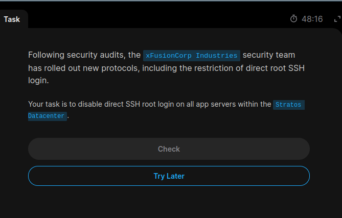
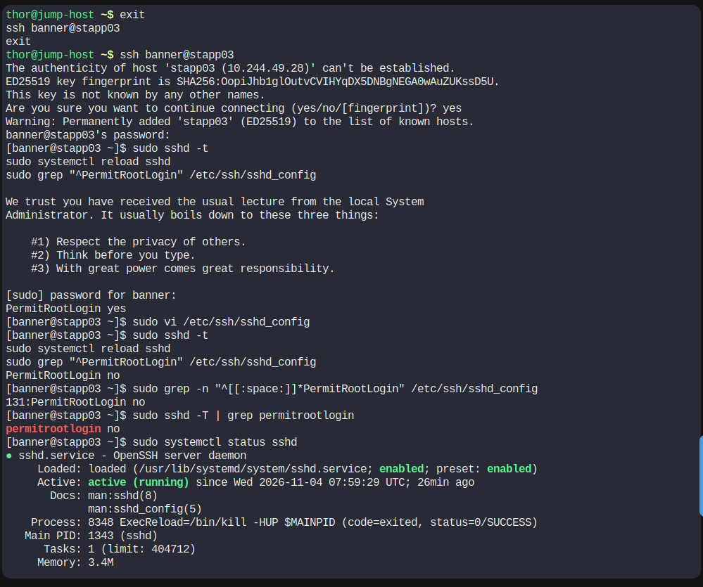

# Task 07: Disable Direct Root SSH Login

## 📌 Task Overview

As part of a security audit, the xFusionCorp Industries security team introduced new security protocols to improve Linux server security.

The requirement was to disable direct SSH login for the `root` user on all application servers in the Stratos Datacenter.

This task helps improve server security by preventing direct remote root access and encouraging administrators to use individual accounts with `sudo` privileges.

## 🎯 Task Requirements

- Disable direct SSH root login.
- Apply the configuration on all three application servers.
- Configure `PermitRootLogin no`.
- Validate the SSH configuration.
- Reload the SSH service to apply the changes.
- Verify the effective SSH configuration.

## 🖥️ Server Information

| Server | Hostname | SSH User |
|---|---|---|
| App Server 1 | stapp01 | tony |
| App Server 2 | stapp02 | steve |
| App Server 3 | stapp03 | banner |

## 🛠️ Implementation Steps

### Step 1: Connect to App Server 1

```bash
ssh tony@stapp01
```

### Step 2: Check Existing SSH Configuration

```bash
sudo grep -n "^[[:space:]]*PermitRootLogin" /etc/ssh/sshd_config
```

This command displays active `PermitRootLogin` directives.

### Step 3: Edit SSH Configuration

Open the SSH configuration file:

```bash
sudo vi /etc/ssh/sshd_config
```

Find the existing `PermitRootLogin` directive and configure:

```text
PermitRootLogin no
```

Ensure there are no conflicting active directives.

### Step 4: Validate SSH Configuration

```bash
sudo sshd -t
```

No output indicates that the SSH configuration syntax is valid.

### Step 5: Reload SSH Service

```bash
sudo systemctl reload sshd
```

This applies the configuration without requiring a complete server reboot.

### Step 6: Verify Effective Configuration

```bash
sudo sshd -T | grep permitrootlogin
```

Expected output:

```text
permitrootlogin no
```

### Step 7: Repeat on Remaining Application Servers

Perform the same configuration on:

**App Server 2:**

```bash
ssh steve@stapp02
```

**App Server 3:**

```bash
ssh banner@stapp03
```

On each server, configure `PermitRootLogin no`, validate the configuration, reload SSH, and verify the effective setting.

## 💻 Important Linux Commands

| Command | Description |
|---|---|
| `ssh` | Connect to a remote server |
| `vi` | Edit configuration files |
| `grep` | Search for configuration directives |
| `sshd -t` | Validate SSH configuration syntax |
| `systemctl reload sshd` | Reload SSH service |
| `sshd -T` | Display effective SSH configuration |
| `sudo` | Execute commands with elevated privileges |

## 🔐 Security Benefits

1. Prevents direct remote root login through SSH.
2. Reduces the risk of brute-force attacks against the root account.
3. Encourages individual user authentication.
4. Improves administrative accountability.
5. Promotes controlled privilege escalation using `sudo`.

## 📸 Screenshot Evidence

### Task Question



### Task Solution



## 📚 Key Learnings

- Understanding SSH server configuration.
- Securing Linux servers by restricting direct root access.
- Working with `/etc/ssh/sshd_config`.
- Understanding the `PermitRootLogin` directive.
- Validating SSH configuration using `sshd -t`.
- Reloading services using `systemctl`.
- Verifying effective SSH settings using `sshd -T`.
- Applying security configurations across multiple Linux servers.

## 🎯 Interview Explanation

**Question: How do you disable direct root SSH login on a Linux server?**

**Answer:**

To disable direct root SSH login, I modify the `/etc/ssh/sshd_config` file and set `PermitRootLogin no`. Then I validate the configuration using `sshd -t` and reload the SSH service using `systemctl reload sshd`. Finally, I verify the effective configuration using `sshd -T | grep permitrootlogin`.

## ✅ Final Result

Configured SSH security settings to disable direct root login on the application servers in the Stratos Datacenter.

**Platform:** KodeKloud Engineer  
**Organization:** xFusionCorp Industries  
**Project:** Nautilus  
**Datacenter:** Stratos  
**Category:** Linux Administration | SSH Security  
**Status:** Completed

---

⭐ Part of my Linux Administration Hands-on Practice Portfolio.

**Author:** Shraddha Wankhade
