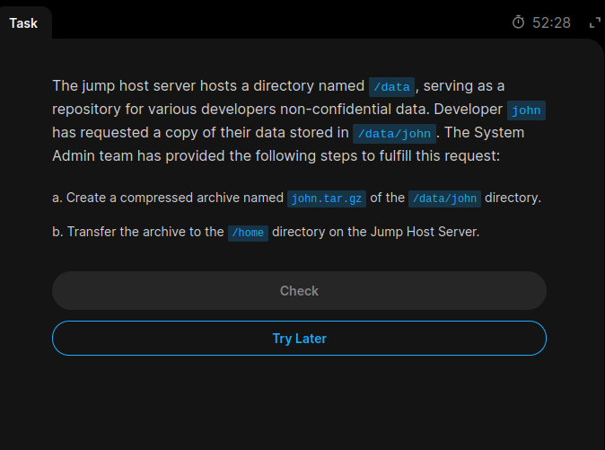
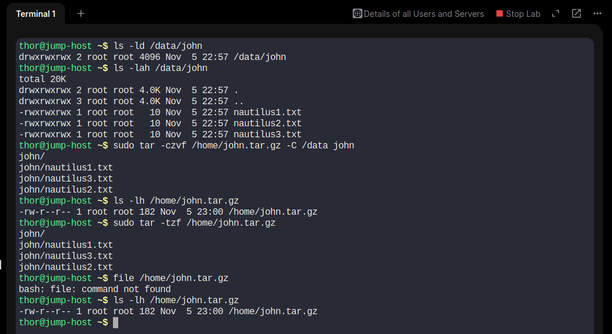

# Day 08 – Create a Compressed Archive Using tar

## 📌 Objective

Create a compressed archive of the `/data/john` directory and store it in the `/home` directory on the Jump Host.

## 📋 Task Requirements

- **Server:** Jump Host
- **Source Directory:** `/data/john`
- **Archive Name:** `john.tar.gz`
- **Destination Directory:** `/home`
- **Compression Format:** gzip

## 🛠️ Implementation Steps

### Step 1: Verify the Source Directory

Command:

```bash
ls -ld /data/john
ls -lah /data/john
```

The directory contained the following files:

- `nautilus1.txt`
- `nautilus2.txt`
- `nautilus3.txt`

### Step 2: Create the Compressed Archive

Command:

```bash
sudo tar -czvf /home/john.tar.gz -C /data john
```

This command creates a gzip-compressed archive named `john.tar.gz` in `/home`.

### Step 3: Verify the Archive

Check the archive file:

```bash
ls -lh /home/john.tar.gz
```

List the archive contents:

```bash
sudo tar -tzf /home/john.tar.gz
```

Verified archive contents:

```text
john/
john/nautilus1.txt
john/nautilus3.txt
john/nautilus2.txt
```

## 📖 Command Explanation

| Option | Description |
|---|---|
| `sudo` | Executes the command with administrative privileges. |
| `tar` | Utility for creating and extracting archives. |
| `-c` | Creates a new archive. |
| `-z` | Compresses the archive using gzip. |
| `-v` | Displays files being processed. |
| `-f` | Specifies the archive filename. |
| `-C /data` | Changes to `/data` before archiving. |
| `john` | Specifies the directory to archive. |

## 📸 Screenshots

### Task Question


### Task Solution


## 🎯 Key Learnings

- Creating compressed archives using `tar`.
- Understanding gzip compression.
- Using `tar -czvf` to create compressed archives.
- Using `tar -tzf` to inspect archive contents.
- Verifying archive location and contents.

## ✅ Final Result

Successfully created and verified the compressed archive:

`/home/john.tar.gz`

The archive contains the `john` directory and all three files.

**Status: Completed**
