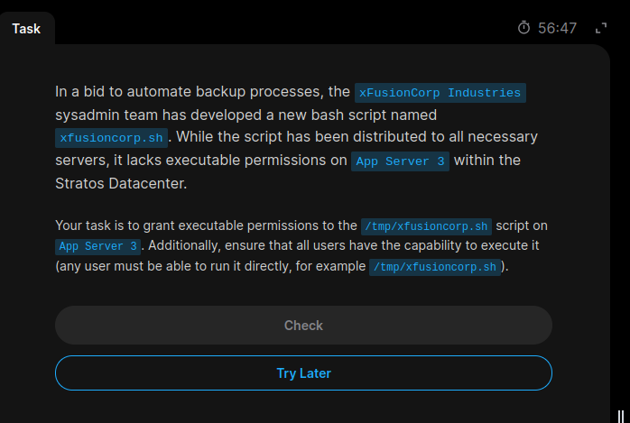
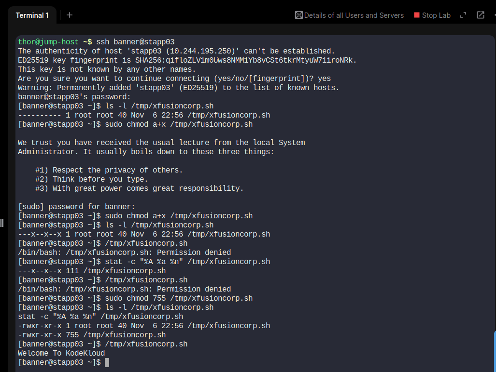

# Task 09 – Grant Execute Permissions to All Users

## 📌 Objective

The objective is to grant executable permissions to the `/tmp/xfusioncorp.sh` script on App Server 3 in the Stratos Datacenter.

All users must be able to execute the script directly.

## 🖥️ Server Details

- **Server:** App Server 3
- **Hostname:** stapp03
- **Username:** banner
- **Script Path:** `/tmp/xfusioncorp.sh`

## 🛠️ Implementation Steps

### Step 1: Connect to App Server 3

```bash
ssh banner@stapp03
```

### Step 2: Check Existing Permissions

```bash
ls -l /tmp/xfusioncorp.sh
```

Initial permissions:

```text
---------- 1 root root 40 /tmp/xfusioncorp.sh
```

The file initially had no read, write, or execute permissions.

### Step 3: Grant Execute Permissions to All Users

```bash
sudo chmod 755 /tmp/xfusioncorp.sh
```

This command sets the following permissions:

| User Category | Permissions | Numeric Value |
|---|---|---|
| Owner | Read, Write, Execute | 7 |
| Group | Read, Execute | 5 |
| Others | Read, Execute | 5 |

### Step 4: Verify Permissions

```bash
ls -l /tmp/xfusioncorp.sh

stat -c "%A %a %n" /tmp/xfusioncorp.sh
```

Expected output:

```text
-rwxr-xr-x 755 /tmp/xfusioncorp.sh
```

### Step 5: Test Script Execution

```bash
/tmp/xfusioncorp.sh
```

This checks whether the script can be executed directly.

## 📸 Screenshots

### Task Question


### Task Solution


## 📚 Key Learnings

- Understanding Linux file permissions.
- Using `chmod` to modify file permissions.
- Understanding numeric permission notation.
- Difference between owner, group, and others.
- Verifying permissions using `ls -l` and `stat`.
- Making scripts accessible for execution by all users.

## ✅ Final Result

The `/tmp/xfusioncorp.sh` script on App Server 3 was configured with `755` permissions.

All users have read and execute permissions, while the owner also has write permission.

**Status: Completed**


