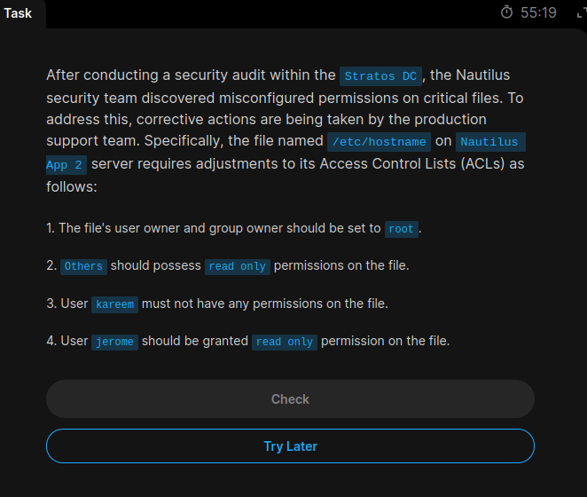
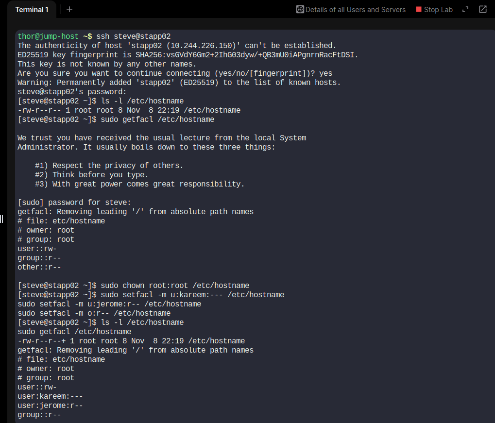

# Task 10 – Configure File Access Control Lists (ACLs)

## 📌 Objective

Configure Access Control Lists (ACLs) on `/etc/hostname` on Nautilus App Server 2 in the Stratos Datacenter.

The security requirements are:

1. Set the file owner to `root`.
2. Set the group owner to `root`.
3. Grant read-only permission to others.
4. Deny all permissions to user `kareem`.
5. Grant read-only permission to user `jerome`.

## 🖥️ Server Details

- **Server:** Nautilus App Server 2
- **Hostname:** stapp02
- **SSH User:** steve
- **File:** `/etc/hostname`

## 🛠️ Implementation Steps

### Step 1: Connect to App Server 2

```bash
ssh steve@stapp02
```

### Step 2: Check Existing Permissions

```bash
ls -l /etc/hostname
sudo getfacl /etc/hostname
```

Initial ownership and permissions:

```text
-rw-r--r-- 1 root root ... /etc/hostname
```

### Step 3: Set Owner and Group

```bash
sudo chown root:root /etc/hostname
```

### Step 4: Configure ACL Permissions

Deny all permissions to `kareem`:

```bash
sudo setfacl -m u:kareem:--- /etc/hostname
```

Grant read-only permission to `jerome`:

```bash
sudo setfacl -m u:jerome:r-- /etc/hostname
```

Grant read-only permission to others:

```bash
sudo setfacl -m o:r-- /etc/hostname
```

### Step 5: Verify ACL Configuration

```bash
ls -l /etc/hostname
sudo getfacl /etc/hostname
```

Verified ACL output:

```text
# owner: root
# group: root
user::rw-
user:kareem:---
user:jerome:r--
group::r--
mask::r--
other::r--
```

## 📖 Command Explanation

| Command | Purpose |
|---|---|
| `chown` | Changes file ownership |
| `setfacl` | Modifies Access Control Lists |
| `getfacl` | Displays ACL permissions |
| `u:kareem:---` | Denies all permissions to kareem |
| `u:jerome:r--` | Grants read-only permission to jerome |
| `o:r--` | Grants read-only permission to others |
| `mask::r--` | Limits effective permissions for named users and groups |

## 📸 Screenshots

### Task Question


### Task Solution


## 📚 Key Learnings

- Understanding Linux Access Control Lists.
- Managing file ownership with `chown`.
- Granting and restricting user-specific permissions.
- Using `setfacl` and `getfacl`.
- Understanding ACL masks and effective permissions.
- Applying Linux file security configurations.

## ✅ Final Result

Successfully configured ACL permissions on `/etc/hostname` on App Server 2.

All specified ownership and access requirements were verified.

**Status: Completed**
