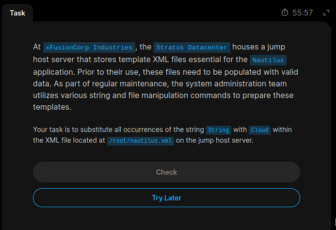
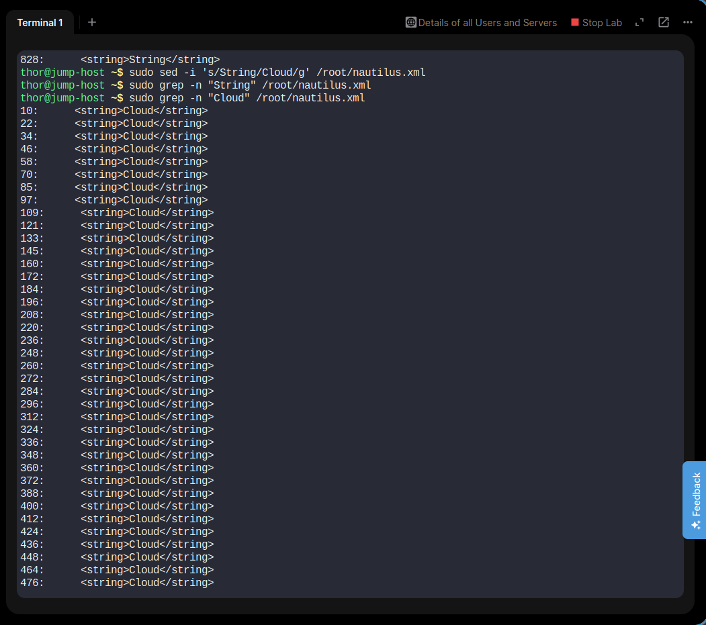

# Task 12 – Replace String with Cloud in XML File

## Objective

Replace all occurrences of the string `String` with `Cloud` in the XML file `/root/nautilus.xml` on the Jump Host server.

## Environment

| Detail | Value |
|---|---|
| Server | Jump Host |
| Hostname | jump-host |
| User | thor |
| File Path | `/root/nautilus.xml` |

## Implementation Steps

### Step 1: Connect to Jump Host

```bash
ssh thor@jump-host
```

### Step 2: Check Existing String Occurrences

```bash
sudo grep -n "String" /root/nautilus.xml
```

This command displays matching lines and their line numbers.

### Step 3: Replace String with Cloud

```bash
sudo sed -i 's/String/Cloud/g' /root/nautilus.xml
```

This command replaces every occurrence of `String` with `Cloud` directly in the original XML file.

### Step 4: Verify the Replacement

Check whether any original occurrences remain:

```bash
sudo grep -n "String" /root/nautilus.xml
```

No output confirms that no matching occurrences remain.

Verify the replacement:

```bash
sudo grep -n "Cloud" /root/nautilus.xml
```

The output displays the updated XML entries containing `Cloud`.

## Command Explanation

| Command / Option | Description |
|---|---|
| `sudo` | Executes the command with elevated privileges. |
| `grep` | Searches for matching text in a file. |
| `-n` | Displays matching line numbers. |
| `sed` | Stream editor used for text manipulation. |
| `-i` | Modifies the original file directly. |
| `s` | Performs a substitution. |
| `String` | Original text to find. |
| `Cloud` | Replacement text. |
| `g` | Replaces all occurrences on each line. |

## Key Learnings

- Linux text manipulation using `sed`.
- Searching file contents using `grep`.
- Replacing multiple string occurrences in an XML file.
- Editing protected files using `sudo`.
- Verifying changes after modifying configuration files.

## Screenshots

### 1. Task Requirements



### 2. Task Solution and Verification



## Final Result

**Status: COMPLETED**

Successfully replaced all occurrences of `String` with `Cloud` in `/root/nautilus.xml` on the Jump Host and verified the changes using `grep`.

