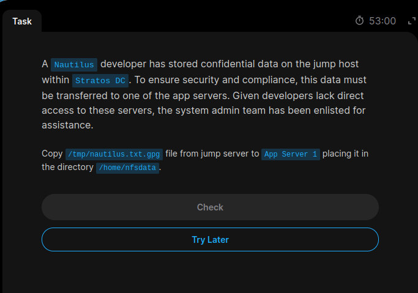
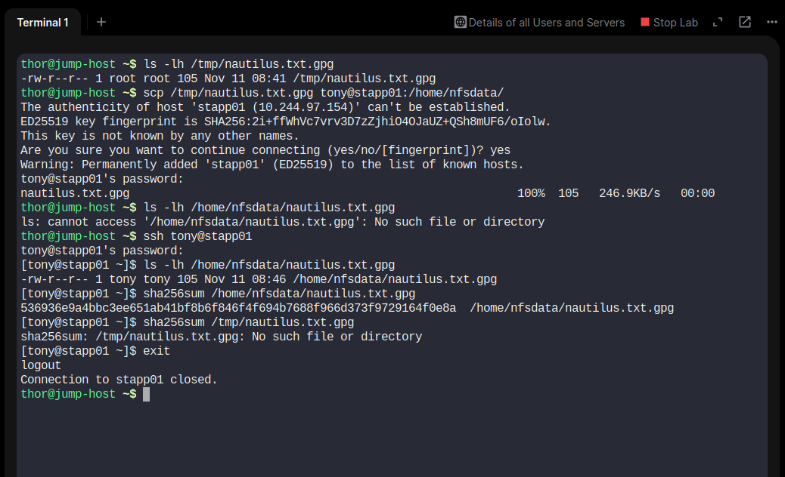

# Day 12 – Copy File Between Servers Using SCP

## Objective

The task was to securely copy the encrypted file `nautilus.txt.gpg` from the Jump Host to App Server 1 and place it inside `/home/nfsdata`.

## Environment Details

| Detail | Value |
|---|---|
| Source Server | Jump Host |
| Source User | thor |
| Source File | `/tmp/nautilus.txt.gpg` |
| Destination Server | App Server 1 |
| Destination Hostname | stapp01 |
| Destination User | tony |
| Destination Directory | `/home/nfsdata` |
| File Name | `nautilus.txt.gpg` |
| File Size | 105 bytes |

## Implementation Steps

### Step 1: Verify the source file

On the Jump Host:

```bash
ls -lh /tmp/nautilus.txt.gpg
```

Output confirmed that the source file existed and its size was 105 bytes.

### Step 2: Transfer the file using SCP

```bash
scp /tmp/nautilus.txt.gpg tony@stapp01:/home/nfsdata/
```

The file was successfully transferred to App Server 1.

Successful transfer output:

```text
nautilus.txt.gpg  100%  105  246.9KB/s
```

### Step 3: Connect to App Server 1

```bash
ssh tony@stapp01
```

### Step 4: Verify the destination file

On App Server 1:

```bash
ls -lh /home/nfsdata/nautilus.txt.gpg
```

Verified output:

```text
-rw-r--r-- 1 tony tony 105 Nov 11 08:46 /home/nfsdata/nautilus.txt.gpg
```

The file was present in the required destination directory.

### Step 5: Check SHA-256 checksum

```bash
sha256sum /home/nfsdata/nautilus.txt.gpg
```

Destination checksum:

```text
536936e9a4bbc3ee651ab41bf8b6f846f4f694b7688f966d373f9729164f0e8a
```

Note: The destination checksum was calculated successfully. A matching source checksum was not yet recorded.

## Command Explanation

| Command | Description |
|---|---|
| `scp` | Securely copies files between remote systems over SSH. |
| `ssh` | Connects to a remote Linux server. |
| `ls -lh` | Displays file details and human-readable file size. |
| `sha256sum` | Calculates the SHA-256 checksum of a file. |

## Key Learnings

- Secure file transfer between Linux servers using SCP.
- Remote server access using SSH.
- Copying encrypted files without decrypting them.
- Verifying file existence, size, ownership, and permissions.
- Checking file integrity using SHA-256 checksums.

## Screenshots

### 1. Task Requirements



### 2. SCP Transfer and Destination Verification



## Final Result

**Status: COMPLETED**

Successfully copied `nautilus.txt.gpg` from the Jump Host to `/home/nfsdata` on App Server 1 using SCP and verified the transferred file.

