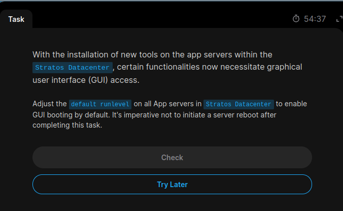
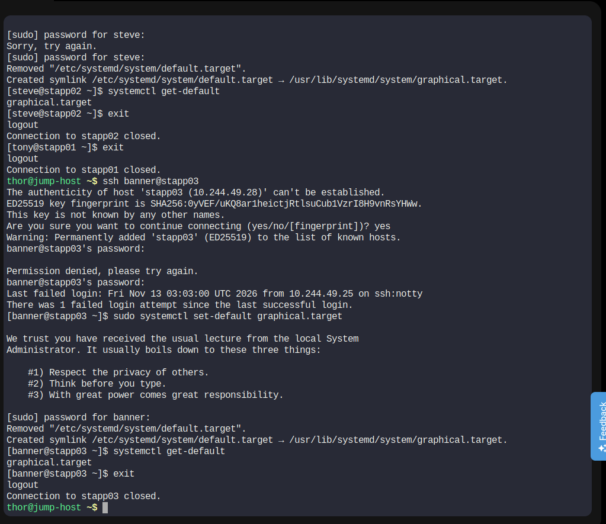

# Task 14 – Configure GUI Default Runlevel

## Objective
Configure the default runlevel on all Application Servers in the Stratos Datacenter to enable GUI booting by default.

**Important:** No server reboot was performed.

## Server Details

| Server | Hostname | Username |
|---|---|---|
| App Server 1 | stapp01 | tony |
| App Server 2 | stapp02 | steve |
| App Server 3 | stapp03 | banner |

## Implementation

### 1. App Server 1

```bash
ssh tony@stapp01
sudo systemctl set-default graphical.target
systemctl get-default
```

### 2. App Server 2

```bash
ssh steve@stapp02
sudo systemctl set-default graphical.target
systemctl get-default
```

### 3. App Server 3

```bash
ssh banner@stapp03
sudo systemctl set-default graphical.target
systemctl get-default
```

## Expected Output

```text
graphical.target
```

## Command Explanation

| Command | Description |
|---|---|
| `systemctl set-default graphical.target` | Sets GUI mode as the default boot target. |
| `systemctl get-default` | Displays the configured default target. |
| `graphical.target` | Systemd target for graphical login. |
| `multi-user.target` | Multi-user command-line mode. |

## Verification Results

| Server | Default Target | Status |
|---|---|---|
| stapp01 | graphical.target | PASS |
| stapp02 | graphical.target | PASS |
| stapp03 | graphical.target | PASS |

## Screenshots

### Task Question


### Task Solution


## Key Learnings

- Modern Linux systems use systemd targets instead of traditional runlevels.
- `graphical.target` enables GUI boot mode by default.
- `systemctl set-default` changes the default boot target.
- `systemctl get-default` verifies the configuration.
- Changing the default target does not require an immediate reboot.

## Final Result

Successfully configured and verified `graphical.target` on all three Application Servers without rebooting any server.

**Status: Completed**

