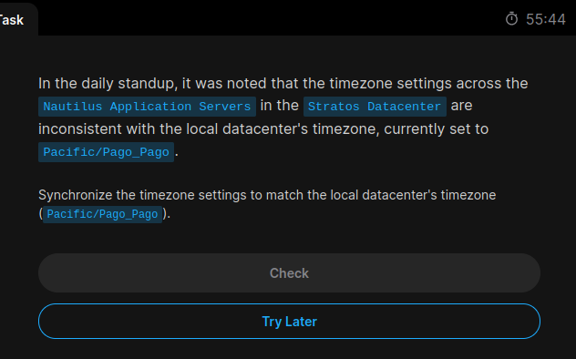
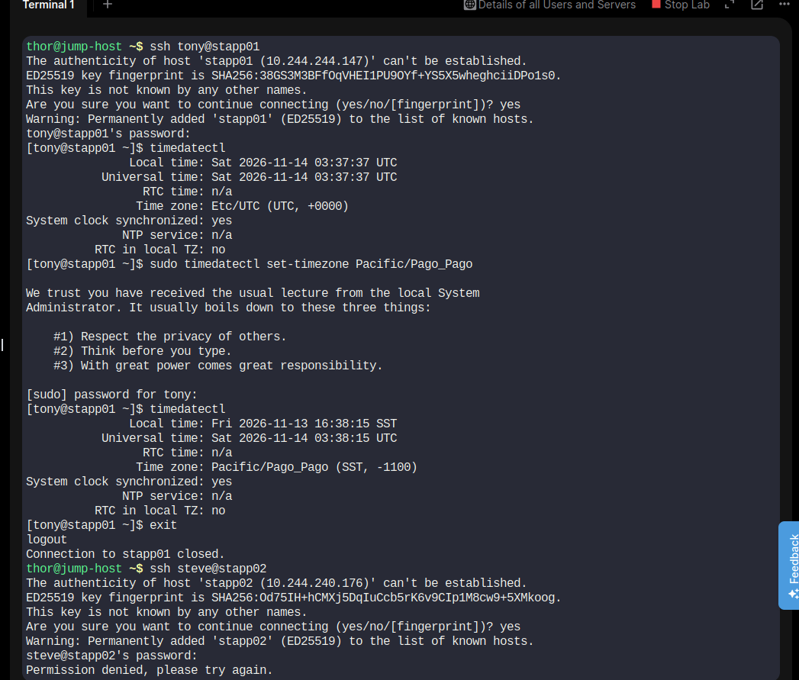
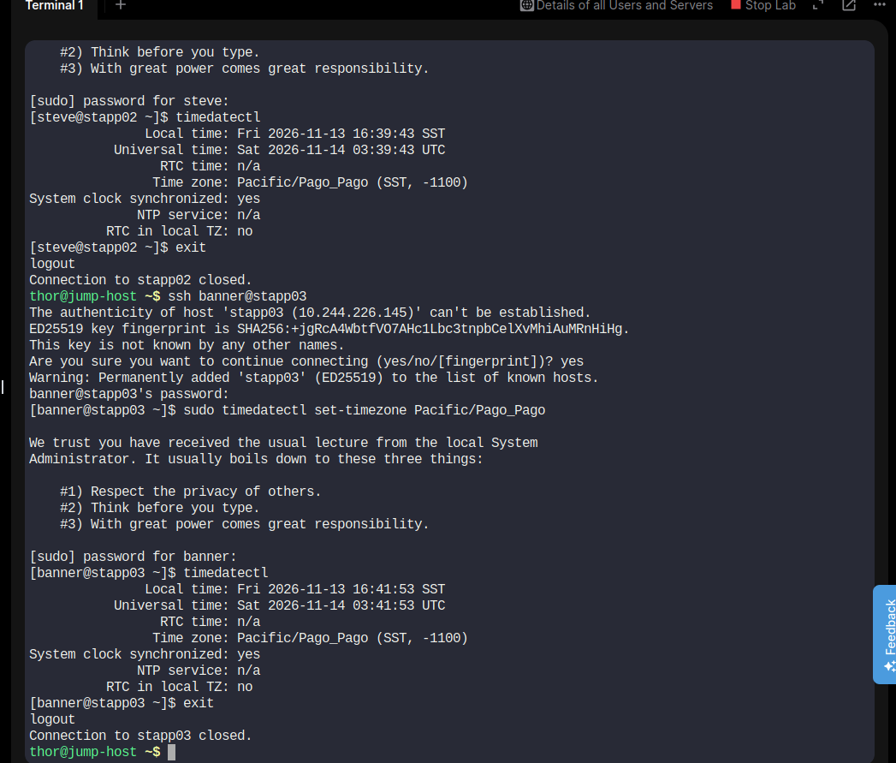

# Task 15 – Configure Timezone on All App Servers

## Objective

The objective was to synchronize the timezone settings across all Nautilus Application Servers in the Stratos Datacenter.

**Required Timezone:** `Pacific/Pago_Pago`

## Server Details

| Server | Hostname | SSH User |
|---|---|---|
| App Server 1 | stapp01 | tony |
| App Server 2 | stapp02 | steve |
| App Server 3 | stapp03 | banner |

## Implementation

### Step 1: Configure Timezone on App Server 1

Connect to App Server 1:

```bash
ssh tony@stapp01
```

Set the timezone:

```bash
sudo timedatectl set-timezone Pacific/Pago_Pago
```

Verify:

```bash
timedatectl
```

### Step 2: Configure Timezone on App Server 2

Connect to App Server 2:

```bash
ssh steve@stapp02
```

Set the timezone:

```bash
sudo timedatectl set-timezone Pacific/Pago_Pago
```

Verify:

```bash
timedatectl
```

### Step 3: Configure Timezone on App Server 3

Connect to App Server 3:

```bash
ssh banner@stapp03
```

Set the timezone:

```bash
sudo timedatectl set-timezone Pacific/Pago_Pago
```

Verify:

```bash
timedatectl
```

## Command Explanation

| Command | Description |
|---|---|
| `timedatectl` | Displays system date, time and timezone information. |
| `timedatectl list-timezones` | Lists available timezones. |
| `sudo timedatectl set-timezone Pacific/Pago_Pago` | Changes the system timezone. |
| `timedatectl status` | Displays current time configuration. |

## Verification

Expected output on all three servers:

```text
Time zone: Pacific/Pago_Pago
```

| Server | Required Timezone | Status |
|---|---|---|
| stapp01 | Pacific/Pago_Pago | Configured |
| stapp02 | Pacific/Pago_Pago | Configured |
| stapp03 | Pacific/Pago_Pago | Configured |

## Screenshots

### 1. Task Question



### 2. Configuration and Verification – Screenshot 1



### 3. Configuration and Verification – Screenshot 2



## Key Learnings

- Linux uses `timedatectl` to manage system date and time settings.
- Timezones are configured using standard timezone database names.
- `timedatectl set-timezone` changes the system timezone.
- `timedatectl` helps verify the current timezone.
- Timezone changes do not require a server reboot.

## Final Result

Successfully configured the timezone `Pacific/Pago_Pago` across all three Nautilus Application Servers in the Stratos Datacenter.

**Task Status: Completed**
